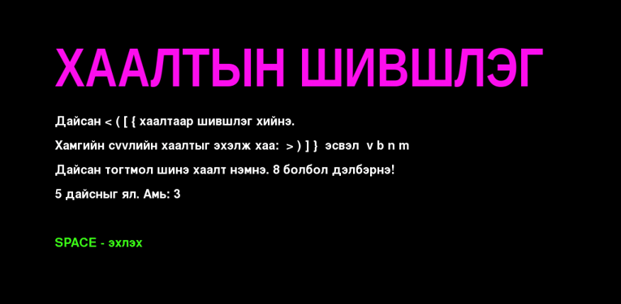
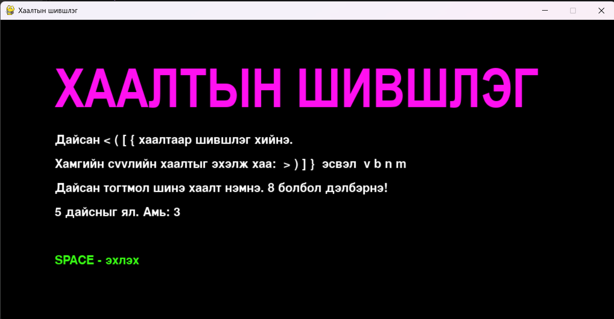
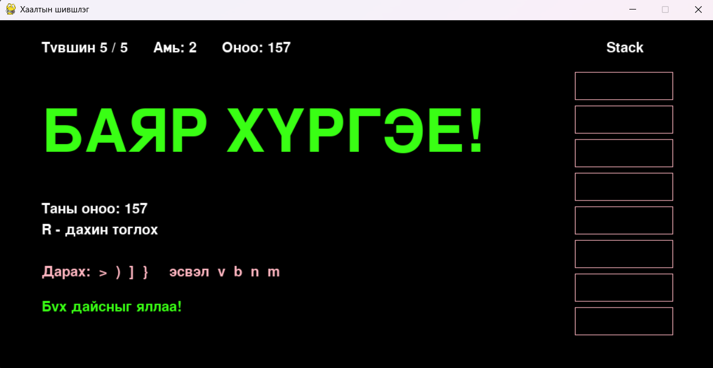

# Bracket Spell · Хаалтын шившлэг



A small Pygame game built around a hand-written **Stack** data structure. An enemy casts a spell made of opening brackets `< ( [ {`. You must close them in the right order (`> ) ] }`), always starting with the most recently opened one. That rule is exactly the Stack's **LIFO** principle. The enemy keeps adding brackets, and if the spell reaches 8 it explodes.

*Made for the Data Structures course (ICSI202) at the National University of Mongolia.*

## Quick start
```bash
pip install -r requirements.txt   # pygame-ce (works on Python 3.10–3.14)
python main.py
```

| Key | Action |
|---|---|
| `>` `)` `]` `}` or `V` `B` `N` `M` | Close the top bracket |
| `Space` | Start |
| `R` | Restart |

## How the Stack is used
| Game event | Stack operation |
|---|---|
| Enemy creates / extends the spell | `push()` |
| Player presses the matching closer | `peek()` → `pop()` |
| Player presses the wrong closer | lose a life (stack unchanged) |
| Enemy casts when the spell is full | `is_full()` → explosion, lose a life |
| Spell cleared | `is_empty()` → next enemy |

`stack.py` implements the stack with linked nodes (no Python `list`), so `push`, `pop` and `peek` are all **O(1)**.

---

## Монгол тайлбар

### Товч тайлбар
Дайсан `<`, `(`, `[`, `{` хаалтуудаар шившлэг үүсгэнэ. Тоглогч хаах тэмдгийг (`>`, `)`, `]`, `}`) зөв дарааллаар дарж шившлэгийг задална. Хамгийн сүүлд нээгдсэн хаалтыг эхэлж хаах ёстой нь Stack-ийн LIFO зарчим юм.

### Хэрхэн тоглох
- **Зорилго:** 5 дайсныг ялах.
- **Оноо:** зөв дарвал +5, буруу дарвал −4.
- **Дайсны довтолгоо:** дайсан хэдэн секунд тутам шинэ хаалт нэмнэ. Ягаан зураас нь дараагийн хаалт хүртэлх хугацаа бөгөөд түвшин ахих тусам хурдална.
- **Ялагдах:** дараах тохиолдолд амь хасагдах ба 3 амь дуусвал ялагдана.
  - Буруу хаалт дарах
  - Шившлэг 8 хүрсэн үед дайсан дахин хаалт нэмэх (дэлбэрэлт)

### Ашигласан өгөгдлийн бүтэц
- **Үндсэн бүтэц:** Stack (`stack.py` → `Node`, `Stack`)
- **Яагаад массив биш вэ:**
  - Тоглоомын дүрэм нь "зөвхөн хамгийн сүүлийнхтэй харьцана" гэсэн LIFO хязгаарлалт. Stack зөвхөн top-д хандах боломж олгодог.
  - `push`/`pop` үргэлж O(1), resize шаардлагагүй.
  - `capacity` нь "шившлэгийн дээд урт" гэсэн дүрэм болно.

### Файлууд
| Файл | Агуулга |
|---|---|
| `stack.py` | Stack-ийн хэрэгжүүлэлт |
| `main.py` | Тоглоомын логик ба Pygame дэлгэц |
| `test_stack.py` | Stack-ийн шалгалт (`python test_stack.py`) |

## Screenshots
| Menu | Win |
|---|---|
|  |  |

